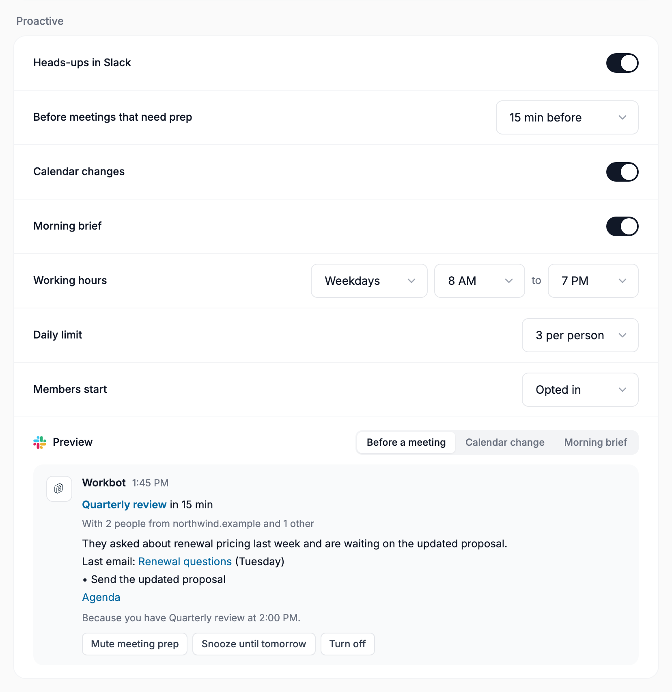
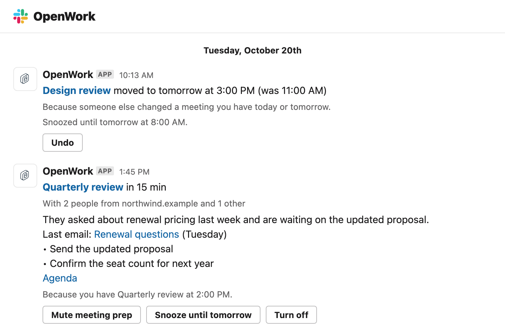

# Workbot: proactive heads-ups

Feature `workbotProactive` (cloud and self-hosted, off by default). Author: `benjaminshafii`.
It also needs Workbot on the deployment (`DEN_WORKBOT_URL`) and the Slack assistant installed.

Workbot wakes up on its own, checks a member's Google Calendar and sends one short Slack DM only when
there is something they need to know. Otherwise it stays quiet. Admins turn it on in Den › Manage › Workbot ›
Proactive. Members control it from every message and from the Slack app's Home tab.

## Architecture

```
wake (schedule today, push later) ─▶ check one member ─▶ notify or stay quiet ─▶ deliver
```

1. **Wake.** A Den loop (`workbot-proactive/worker.ts`) claims members whose `next_check_at` is due, with a row
   lease, so several Den replicas never check the same member twice. Only a schedule or (later) a calendar push
   wakes a check; the model never schedules its own.
2. **Gates.** Feature, Workbot deployed, the organization switch, the member's opt-in, snooze, working days and
   hours in the member's calendar time zone.
3. **Observe (read-only).** One Google Calendar `events.list` as the member (primary calendar, today and
   tomorrow, `showDeleted`). Only `GET` calls.
4. **Detect (pure).** `@openwork/automations/proactive` diffs the events against the member's checkpoint and
   returns signals: meeting prep, calendar changes, morning brief.
5. **Policy (pure).** Enabled kinds, muted kinds, the daily cap and the notification ledger
   (event id plus updated time, one message per event).
6. **Decide.** Changes and the brief are composed in code. Meeting prep runs one **read-only** headless-runner
   turn: a fresh session with no history, owner or memory, a read-only MCP token, a `[routine]` prompt marked as
   not from the person, and `NO_REPLY` as the default answer. `NO_REPLY` or anything unparsable sends nothing.
7. **Deliver.** One Slack DM from the Slack assistant's bot: a "Because…" line, then Mute, Snooze until tomorrow
   and Turn off. Pressing one updates the message in place with an Undo.
8. **Remember.** An encrypted checkpoint per member and one ledger row per event. Nothing goes into a
   conversation, memory or the runner (the check's session is deleted afterwards).

## Calendar event map

| What happened | How it is detected | What the member gets | Dedupe key |
| --- | --- | --- | --- |
| A meeting starts within the lead time and has someone from outside the company or an agenda doc | `start − now ≤ lead time`, external attendee domain, or a Docs/Drive link or attachment | A read-only check finds the last related thread and open items. One DM, or nothing if it finds nothing useful | event id + start |
| Someone else added a meeting for today or tomorrow | Not in the checkpoint, `created` after the last check, organizer is not the member | One grouped "Your calendar changed" DM | event id + updated |
| A meeting today or tomorrow moved | Start or end differs from the checkpoint | Same grouped DM, with the old time | event id + updated |
| A meeting today or tomorrow was cancelled | Status became `cancelled` | Same grouped DM | event id + updated |
| Start of a working day (morning brief on) | First check in the first three working hours | Today's meetings, overlaps and what needs prep, with any overnight changes folded in | date |
| Ignored | Changes the member made themselves, declined meetings, all-day events, focus time, out of office, working location, meetings with nobody else, anything after tomorrow | Nothing | n/a |

The first check only records the calendar: nothing that already existed is reported as new. While a check
waits (outside working hours, snoozed), changes simply accumulate. The next check reports only what is still
true and still today or tomorrow.

## Admin settings (organization metadata `workbot.proactive`)

| Field | Default | Choices |
| --- | --- | --- |
| `enabled` (Heads-ups in Slack) | off | on/off for the organization |
| `meetingPrep` + `leadMinutes` (Before meetings) | on, 15 | Off, 5, 10, 15, 30 or 60 minutes before |
| `calendarChanges` (Calendar changes) | on | on/off |
| `morningBrief` (Morning brief) | off | on/off |
| `workingDays`, `startHour`, `endHour` (Working hours) | Weekdays, 8–19 | Weekdays or Every day; whole hours, in each member's calendar time zone |
| `dailyCap` (Daily limit) | 3 | 1–10 messages per member per day |
| `membersStart` (New members) | `opted_in` | `opted_in` (they get heads-ups and can turn them off) or `opted_out` (they turn them on in Slack) |

The page shows a live preview of each message kind. Controls stay visible but locked, with a reason, when the
Slack app is not installed, the headless runner is missing (meeting prep only), or the viewer lacks
**Manage OpenWork Models** (DESIGN.md P4, C5).

## Member controls (Slack)

- Each DM ends with "Because you have *Quarterly review* at 2:00 PM." and three buttons: **Mute meeting prep**
  (or the matching kind), **Snooze until tomorrow**, **Turn off**. Each records the choice, then replaces the
  buttons with what happened and an **Undo**.
- The Slack app's **Home** tab answers "what will you notify me about?". It lists what is on, the hours and the
  daily limit, with Turn on / Turn off, Resume and Unmute.

## Safety

- **Read-only.** The calendar read is a `GET`. The meeting-prep turn uses an `mcp:read` token and the runner's
  read-only tool set, so it cannot send, edit or accept anything. Anything the member wants done goes back
  through a normal Workbot or Slack conversation, with normal approvals.
- **No memory pollution.** Background reading never enters the member's Workbot conversation or memory. The
  check's runner session has no owner and is deleted after the answer is read.
- **At most once.** A ledger row is reserved before sending, so a crash never sends twice. Silence wins on any
  doubt: an unparsable answer, a runner outage, or a failed model check all mean no message.
- **Restraint.** Weekdays from 8 to 19 by default, at most 3 a day, one message per event, polling every five
  minutes only inside working hours.

## Turning it off

The kill switch (or the organization switch) stops new checks on the next tick. A check already running
re-reads the feature right before posting. Stored settings, checkpoints and ledger rows stay, and are harmless.
Buttons on old messages answer quietly without changing anything. The Home tab hides the section.

## How it maps to OpenWork (desktop, Automations)

The pipeline is generic: **trigger → read-only check → notify or stay quiet → delivery**.

- The trigger detection, policy, wake prompt and `NO_REPLY` parsing live in `@openwork/automations/proactive`,
  the pure package hosted and on-prem Den already use for Automations. It has no Slack or Den dependencies.
- **Calendar trigger as an Automation trigger.** Automations today have `once/daily/weekly` schedules. A
  `calendar` trigger kind would run the same `detectCalendarSignals` on a schedule and admit one Automation run
  per signal, with the signal's dedupe key as the occurrence identity.
- **Read-only check = a headless Automation run** with `readOnly: true`, `PROACTIVE_CHECK_INSTRUCTIONS` and the
  quiet parser applied to the result summary (`executeHeadlessAgent` already creates a fresh session per run).
- **Delivery** becomes a port: Slack DM today, and a desktop notification or the Automation's result card later.

Follow-ups (not in this PR):

1. Google Calendar push (`events.watch`) calling the existing wake path instead of polling.
2. A `calendar` Automation trigger kind and `readOnly` on `executeHeadlessAgent`, reusing the pure core.
3. Desktop delivery (a notification plus the result in the Automation's history).
4. Outlook calendars through the existing Microsoft 365 connection.
5. A weekly line on the admin page ("12 heads-ups to 5 people, 30 checks stayed quiet") from the ledger.
6. Smarter "external": the organization's verified email domains instead of the member's own domain.

## Try it locally

```sh
pnpm dev:den:mysql && pnpm dev:workbot
# /admin › Features › Workbot: proactive heads-ups › on for your organization
# Den › Manage › Workbot › Proactive › Heads-ups in Slack
```

The Slack app must be installed with interactivity, and the member must have connected Slack and Google
Workspace. `pnpm --filter @openwork/automations test` and `pnpm --filter @openwork-ee/den-api test` cover the
detection, policy, parsing, message composition and controls without Slack or Google.




